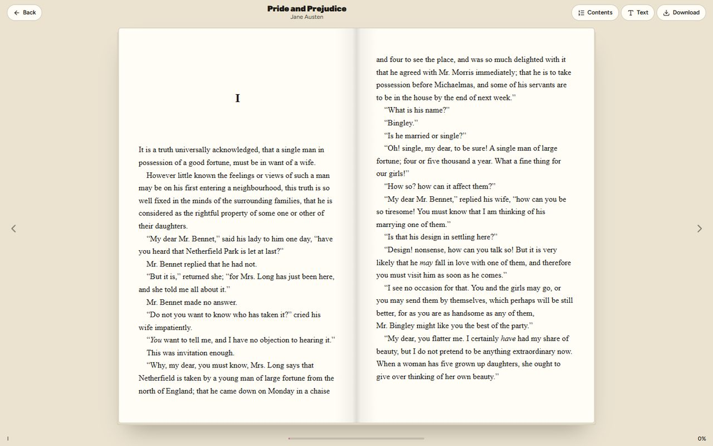

<h1 align="center">The Bookshelf</h1>

<p align="center"><strong>A free library of 144 classics to read in your browser or download, in a bright, playful site where everything moves.</strong></p>

<p align="center">
  <a href="https://cl0ud-9.github.io/Book-Website/"></a>
</p>

<p align="center">
  <a href="https://github.com/Cl0ud-9/Book-Website/actions/workflows/pages.yml"></a>
  <a href="LICENSE"></a>
  
  
</p>

<br>

<p align="center">
  
</p>

The Bookshelf is a free library of the classics with a loud, warm personality: heavy type, handwritten notes,
colour cards, stickers and motion everywhere you look. 144 books, from Austen and the Brontës to Sherlock Holmes,
Frankenstein and Gatsby, can be read right in the browser or downloaded for a phone, Kindle or Kobo. It began as a
Web Technology course project, was rebuilt as an animated bookshop in version 2, and became a library in version 3.

| Page | What it does |
|---|---|
| [Home](https://cl0ud-9.github.io/Book-Website/) | Where to start, on a draggable shelf; the books you are reading; how it works; a book that opens as you scroll; eleven genres; questions; the book of the month. |
| [All books](https://cl0ud-9.github.io/Book-Website/books.html) | All 144 books, most read first, searchable by title, author or genre (accents optional), with genre chips and sorting by title or length. Genre links on the home page open it already filtered. |
| [Genres](https://cl0ud-9.github.io/Book-Website/genres.html) | A shelf for each of the eleven genres, its most read books first, to scroll or drag sideways. |
| [Questions](https://cl0ud-9.github.io/Book-Website/faq.html) | Every question, by topic, with a list of topics that follows you down the page and marks the one you are reading. |
| [A book](https://cl0ud-9.github.io/Book-Website/book-pride-and-prejudice.html) | Every book has its own page: a 3D copy that leans towards the pointer, its description and details, Read now, the EPUB download, Kindle and Kobo editions, and three related books. |
| [The reader](https://cl0ud-9.github.io/Book-Website/read.html?book=pride-and-prejudice) | The book itself, in the page: its cover swings open, then pages turn on a laptop and scroll on a phone, with contents, text size, three page colours and three fonts. It remembers your place. |
| [Log in](https://cl0ud-9.github.io/Book-Website/login.html) and [Sign up](https://cl0ud-9.github.io/Book-Website/signup.html) | Forms checked in the browser, with an error beside each field. |

## The details

<p align="center">
  
  
</p>

- **Page transitions.** A fat violet squiggle draws itself across the screen, the logo springs in, the next page
  loads behind it, and the squiggle slithers off again (Barba, DrawSVG). It is scaled evenly and cropped, so its ends
  stay round on any screen shape. Going back or forward swaps the page at once: phones already animate those moves
  with their own gesture, and a squiggle on top would play after the page had appeared.
- **Type.** Three roles, as on the site that inspired the design: heavy headings (Rubik 900), clean text (Figtree)
  and handwritten notes (Gochi Hand), each the closest free match to the original's font by measured overlap.
  Headings stretch in word by word with an elastic snap, notes tumble in letter by letter, and button letters dip and
  spring back.
- **A real library.** The books are Standard Ebooks editions: carefully proofread, beautifully typeset and released
  into the public domain, with covers made from public-domain paintings. Every one is also out of copyright in India
  (where copyright runs for the author's life plus 60 years), so authors such as Agatha Christie are left out.
- **A reader in the page.** epub.js shows the book itself. It opens with the book's own cover, which swings open on
  the desk. On a wide screen the book lies open on two facing pages with a spine between them, and each turn lifts a
  leaf across the spine; on a phone the whole screen is the page, and the bars slip away while you read on and come
  back when you scroll up or tap. Turn pages with the arrows, the keys or a swipe, jump through the contents (which
  marks the chapter you are in), and pick the text size, page colour and font. Your place is kept on your device, so
  the book page offers to continue and the home page lists what you are reading. Its scripts load only when a book
  is opened.
- **A shelf you can throw.** Cards tilt and dip the further they are from the middle as you drag (Smooothy), with
  arrow buttons, arrow keys and a sideways trackpad swipe too.
- **A book that opens as you scroll.** It turns to face you, the cover swings open, three pages flip, and you fall
  into the page where the headline is waiting. All of it is CSS 3D, driven by the scroll position (ScrollTrigger).
- **Genres with covers.** The genre under the pointer swaps to handwriting, its neighbours make room, and four
  covers pop out around it and drift with the pointer.
- **Books you can open.** Each book page has a 3D copy that follows the pointer, and downloading a book sets off a
  burst of confetti.
- **Little things.** Background shapes that breathe, stickers that slap on, a ring of text that turns as you scroll,
  a tagline that runs along a curve, ribbons that reverse when you scroll up, a shower of confetti in the brand
  colours, stickers you can fling with the pointer (Inertia), a footer that slides out from under the page with a
  giant wordmark, and a bookmark that wiggles on the current menu item. Icons are from Lucide.

<p align="center">
  
  
</p>

<p align="center">
  
</p>

<p align="center">
  
</p>

## Built to work for everyone

- **Reduced motion.** With the system setting on, nothing slides, spins or scrolls itself: pages appear at once and
  the book scene becomes a plain section.
- **No JavaScript.** Every page is complete and readable, with real links between them, and every book can still be
  downloaded; only the reader needs JavaScript.
- **Keyboard and screen readers.** A skip link, labelled fields, visible focus, sliders driven by the arrow keys, genre
  covers that follow keyboard focus, a phone menu that keeps focus inside and closes with Escape, and animated text
  that is still read out as whole sentences.
- **Smooth on a phone.** Measured frame by frame on a real Android phone (Chrome, 60 Hz): scrolling the home page
  drops about one frame in nine, down from one in four, and page changes, the menu and going back hold 60 fps. Text is
  put back together once it has landed, only what moves gets a layer of its own, the background shapes rest while you
  scroll, and the curved tagline moves letter by letter on the graphics card. The opening does its heavy setup while
  the squiggle still covers a still screen.
- **Fast anyway.** Fonts and libraries are served with the site, so it makes no requests to other servers. The three
  fonts are cut down to the characters used (50 KB together) and the covers are WebP in four widths. Lighthouse on
  a phone, on the live site:

  | Page | Performance | Accessibility | Best practices | SEO | Downloads |
  |---|---|---|---|---|---|
  | Home | 81 to 96 | 100 | 100 | 100 | 687 KB |
  | All books | 89 to 91 | 100 | 100 | 100 | 545 KB |
  | A book page | 70 to 98 | 100 | 100 | 100 | 489 KB |
  | The reader | 70 to 97 | 100 | 100 | 100 | 1,073 KB, most of it the book |
  | Log in, Sign up | 99 | 100 | 100 | 100 | 197 KB |

  Performance swings from run to run on GitHub Pages; the painted covers weigh more than the old flat drawings did.

## Run it

With Node.js 18 or newer:

```bash
npm install
npm start          # http://localhost:3000
```

Opening `index.html` straight from the disk works too, but browsers do not let a page fetch other files from disk, so
links load the next page normally instead of playing the transition.

An unfinished port of the original site to Angular, from the same course, is kept on the
[`angular-port`](https://github.com/Cl0ud-9/Book-Website/tree/angular-port/angular) branch.

## Using the original fonts

The design follows a site set in Champ, Degular and Hello Organichand. Those are paid fonts, licensed to that site,
so this repository uses the closest free fonts instead. With your own licence, put the font files in `fonts/` and point
the three `@font-face` rules at the top of `css/main.css` at them; the rest of the site uses `--font-heading`,
`--font-body` and `--font-hand` and needs no other change.

## Changing the books

The shelf is one list, `CATALOGUE` in `tools/library.py`: a Standard Ebooks edition and its genres here. The library
script fetches each book's details, cover and EPUB (slowly, and only once: they are cached), and the build writes every
page from what it fetched. What the home page features is `FEATURED` in `tools/build.py`.

**How the books are ranked.** Standard Ebooks lists its whole catalogue by how often each book is downloaded there;
the library script records each book's place in that list (`popularity`), and the site orders by it: All books,
every genre shelf and Where to start (the top ten) show the most read first, and Not sure where to begin? offers the
most read book of each mood. `python tools/library.py --refresh-popularity` fetches the list again.

**The book of the month** comes from the twelve most read books whose first line the library script could take from
the EPUB, one each month in turn, so a year shows all twelve. It opens with that real first line. The site is rebuilt on the first of every month, so
the pick changes by itself. Each month's pick is written down a year ahead in `library/picks.json` (edit it to choose
a different book), so adding books never changes a month that is already showing. The hero, the open book and the gift are chosen by hand, for how their covers look.

```bash
python tools/library.py    # fetches new books into library/books.json, image/covers/ and books/ (needs Pillow)
python tools/build.py      # rewrites every page, including one per book
python tools/check.py      # with npm start running: uses the site like a visitor and reports what fails
python tools/effects.py    # with npm start running: checks every hover effect after links, Back and Forward
python tools/social.py     # with npm start running: redraws the link previews and the home-screen icon
python tools/fonts.py      # rebuilds the three fonts from their sources (needs fonttools and brotli)
```

`tools/check.py` drags the shelf, hovers the genres, opens the questions, sends the forms (including one with HTML in
it), follows a genre link into the catalogue, searches and sorts it (without accents), opens a book, checks its
download, goes back, reads it in the reader (turning pages, changing the page colour, and coming back to "Continue"),
opens Genres and Questions from a book's page (dragging a shelf, jumping between topics, and following a link to a
section of another page), and checks the phone menu (and that it steps aside while you read), the reader's bars on a
phone, that going back returns to where you were, that long titles fit their cards, that no page is ever wider than
a 320 px phone, reduced motion and the site without JavaScript.

## How it is published

Every push to `main` runs [`.github/workflows/pages.yml`](.github/workflows/pages.yml): it copies the site, rebuilds
the pages for the day (for the book of the month), checks that every local link, image, cover size and font it names
exists, runs Lighthouse in its phone mode on five pages (three runs each, budgets in
[`.lighthouserc.json`](.lighthouserc.json)), and deploys it to GitHub Pages. A broken link, or a page that falls below
its speed or accessibility budget, stops the deploy. It also runs on the first of every month.

**Counting visits (optional).** Create a free site at [GoatCounter](https://www.goatcounter.com) and put its code (the
`bookshelf` in `bookshelf.goatcounter.com`) in a repository variable named `GOATCOUNTER` (Settings, Secrets and
variables, Actions, Variables). The next deploy adds the counter: page views, and each book opened, reaching its
second chapter, finished or downloaded. GoatCounter uses no cookies and keeps nothing personal, and browsers that ask
not to be tracked are not counted at all.

## Honest limits

- **No back end.** The forms check what you type and show a message. Nothing is sent or stored, so there are no real
  accounts or newsletter yet; your place in a book is kept in your own browser, so it does not follow you to another
  device.
- **Classics only.** Recent books, such as Colleen Hoover's, and manga such as One Piece are under copyright and
  cannot be shared for free. The site says where to borrow them instead.
- **Some books are fetched.** The few heavily illustrated editions over 8 MB are read and downloaded straight from
  Standard Ebooks rather than kept here, to keep the repository small, and so are books whose EPUB the library script
  has not copied yet (Standard Ebooks limits how many a day it hands out).
- **The motion takes a moment.** The opening animation runs before the page is fully shown, which costs some time on a
  slow phone. Reduced motion skips it.

## Project structure

```text
index.html, books.html, genres.html, faq.html, book-*.html, read.html,
login.html, signup.html, 404.html    generated by tools/build.py
css/main.css        every style: tokens, the fluid type scale, components and sections
js/app.js           transitions, smooth scrolling and every animation, one function per effect
js/forms.js         checks the log-in, sign-up and newsletter forms
js/vendor/          GSAP, Lenis, Barba, Smooothy, epub.js and JSZip, unchanged (licences in LICENSES.md)
js/reader.js        the reader (with js/vendor/epub.min.js and jszip.min.js, loaded only on read.html)
library/books.json  every book's details, written by tools/library.py
books/              the EPUB files (bigger illustrated editions are fetched from Standard Ebooks instead)
fonts/              Rubik (headings), Figtree (text) and Gochi Hand (notes), Latin subset, built by tools/fonts.py
image/              covers (covers/<book>-180/360/720/1080.webp), link previews (social/), the logo and home-screen icon
sitemap.xml         every page, for search engines
tools/              library, page, font and preview generators, icons and the browser checks
server.js           optional local server (npm start)
```

## License

**Source-available**: Copyright 2023-2026 Cloud/9, all rights reserved. You can read the code, run it yourself and
fork it to contribute back. Redistributing it, hosting copies, using it for a business or using it to train AI models
is not allowed without written permission. See [LICENSE](LICENSE). The libraries and fonts keep their own licenses,
listed in [NOTICE](NOTICE). See [CONTRIBUTING.md](CONTRIBUTING.md), [SECURITY.md](SECURITY.md) and
[CHANGELOG.md](CHANGELOG.md).

<br>

<p align="center">
  <sub>Made by <a href="https://github.com/Cl0ud-9">Cloud/9</a>.</sub>
</p>
