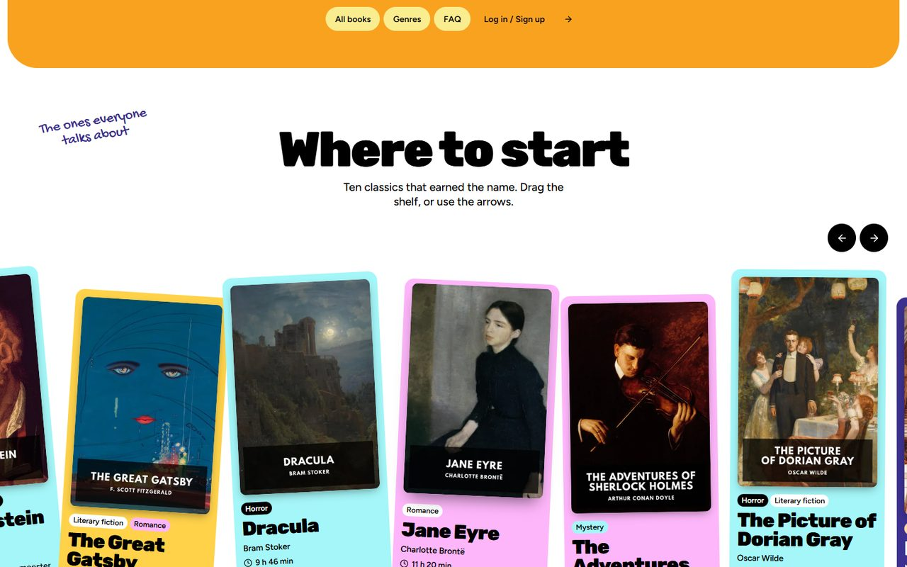
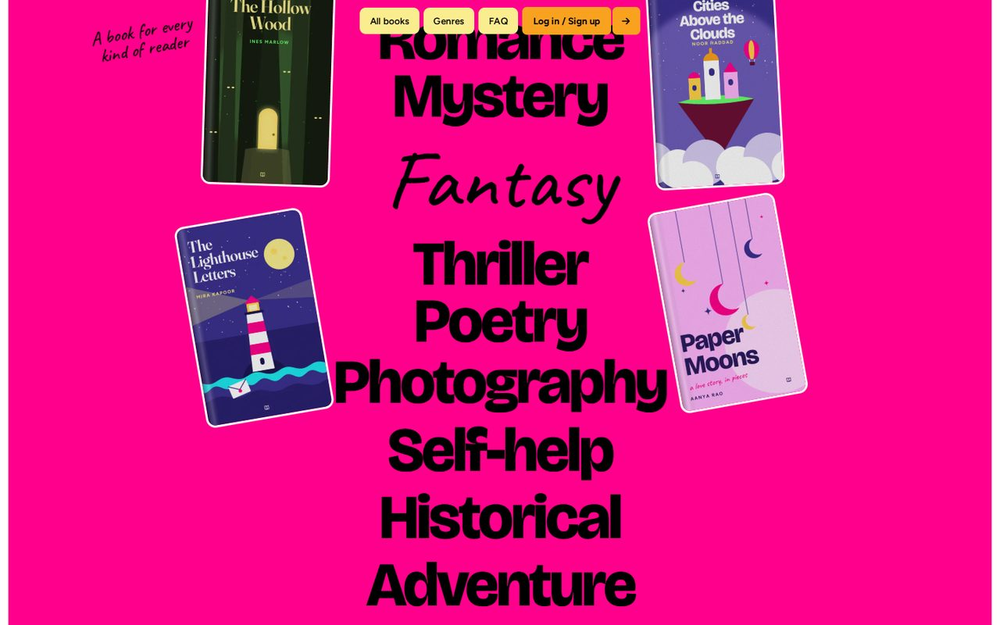
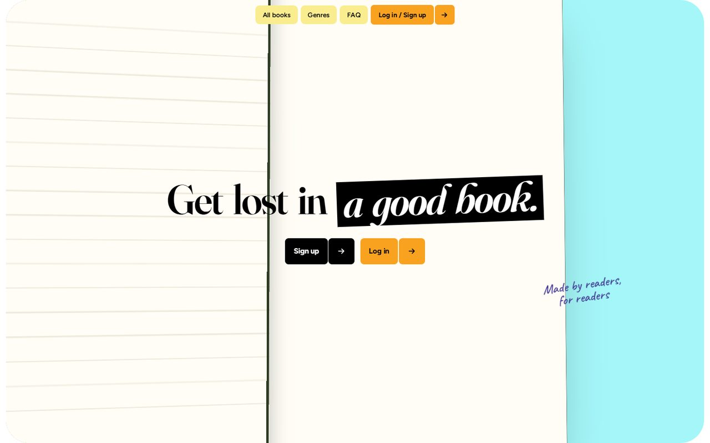
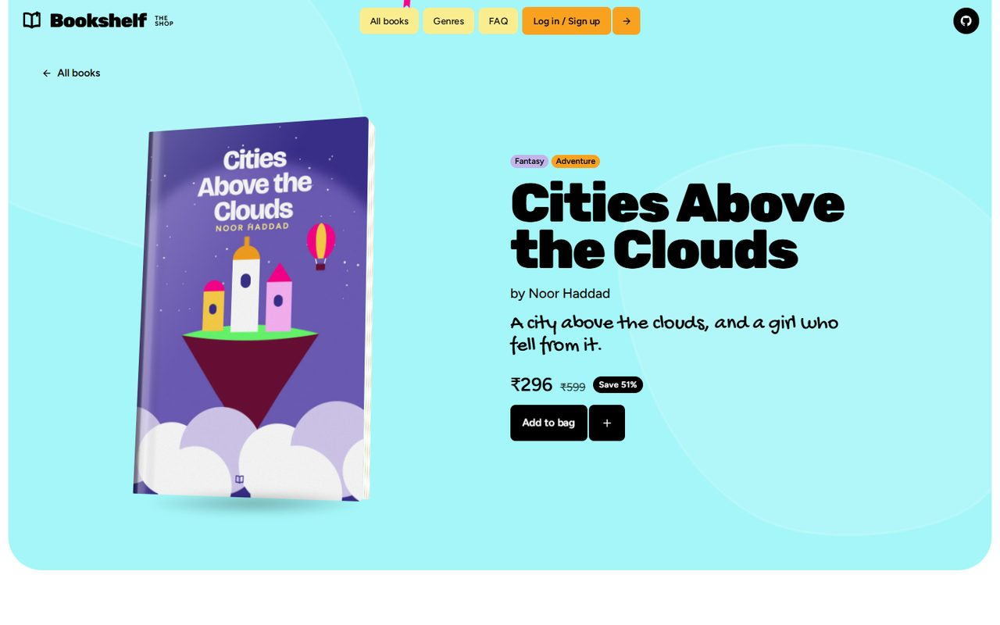
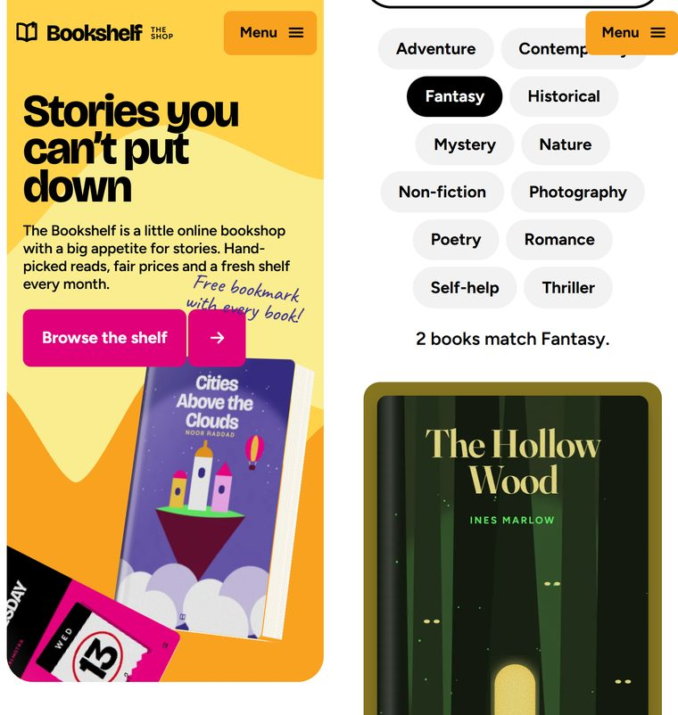

<h1 align="center">The Bookshelf</h1>

<p align="center"><strong>A bright, illustrated bookshop where everything moves: page transitions, a book that opens as you scroll, and a shelf you can drag.</strong></p>

<p align="center">
  <a href="https://cl0ud-9.github.io/Book-Website/"></a>
</p>

<p align="center">
  <a href="https://github.com/Cl0ud-9/Book-Website/actions/workflows/pages.yml"></a>
  <a href="LICENSE"></a>
  
  
</p>

<br>

<p align="center">
  
</p>

The Bookshelf is an imaginary bookshop with a loud, warm personality: heavy type, handwritten notes, colour cards,
stickers and motion everywhere you look. It began as a Web Technology course project and was rebuilt from
scratch in version 2. Every book, cover and illustration on it was made for the site.

| Page | What it does |
|---|---|
| [Home](https://cl0ud-9.github.io/Book-Website/) | Ten new books on a draggable shelf, how it works, a book that opens as you scroll, a giant genre list, why the shop, questions, gift cards, readers' favourites and the pick of the month. |
| [All books](https://cl0ud-9.github.io/Book-Website/books.html) | Every book, searchable by title, author or genre, with genre chips. Genre links on the home page open it already filtered. |
| [A book](https://cl0ud-9.github.io/Book-Website/book-cities-above-the-clouds.html) | Each of the ten books has its own page: a 3D copy that leans towards the pointer, the details, Add to bag, and three related books. Every card on the site opens one. |
| [Log in](https://cl0ud-9.github.io/Book-Website/login.html) and [Sign up](https://cl0ud-9.github.io/Book-Website/signup.html) | Forms checked in the browser, with an error beside each field. |

## The details

<p align="center">
  
  
</p>

- **Page transitions.** A fat violet squiggle draws itself across the screen, the logo springs in, the next page
  loads behind it, and the squiggle slithers off again (Barba, DrawSVG). It is scaled evenly and cropped, so its ends
  stay round on any screen shape. Going back or forward swaps the page at once: phones already animate those moves
  with their own gesture, and a squiggle on top would play after the page had appeared.
- **Type.** Three roles, as on the site that inspired the design: heavy headings (Rubik 900), clean text (Figtree)
  and handwritten notes (Gochi Hand), each the closest free match to the original's font by measured overlap.
  Headings stretch in word by word with an elastic snap, notes tumble in letter by letter, and button letters dip and
  spring back.
- **A shelf you can throw.** Cards tilt and dip the further they are from the middle as you drag (Smooothy), with
  arrow buttons and arrow keys too.
- **A book that opens as you scroll.** It turns to face you, the cover swings open, three pages flip, and you fall
  into the page where the headline is waiting. All of it is CSS 3D, driven by the scroll position (ScrollTrigger).
- **Genres with covers.** The genre under the pointer swaps to handwriting, its neighbours make room, and four
  covers pop out around it and drift with the pointer.
- **Books you can open.** Each book page has a 3D copy that follows the pointer, and Add to bag answers with a burst
  of confetti.
- **Little things.** Background shapes that breathe, stickers that slap on, a ring of text that turns as you scroll,
  a tagline that runs along a curve, ribbons that reverse when you scroll up, a shower of confetti in the brand
  colours, stickers you can fling with the pointer (Inertia), a footer that slides out from under the page with a
  giant wordmark, and a bookmark that wiggles on the current menu item. Icons are from Lucide.

<p align="center">
  
  
</p>

<p align="center">
  
</p>

## Built to work for everyone

- **Reduced motion.** With the system setting on, nothing slides, spins or scrolls itself: pages appear at once and
  the book scene becomes a plain section.
- **No JavaScript.** Every page is complete and readable, with real links between them.
- **Keyboard and screen readers.** A skip link, labelled fields, visible focus, sliders driven by the arrow keys, genre
  covers that follow keyboard focus, a phone menu that keeps focus inside and closes with Escape, and animated text
  that is still read out as whole sentences.
- **Fast anyway.** Fonts and libraries are served with the site, so it makes no requests to other servers. The three
  fonts are cut down to the characters used (50 KB together) and the covers are WebP in four widths. Lighthouse on
  a phone, on the live site:

  | Page | Performance | Accessibility | Best practices | SEO | Downloads |
  |---|---|---|---|---|---|
  | Home | 89 to 97 | 100 | 100 | 100 | 501 KB |
  | All books | 95 to 99 | 100 | 100 | 100 | 335 KB |
  | A book page | 95 to 99 | 100 | 100 | 100 | 289 KB |
  | Log in, Sign up | 98 | 100 | 100 | 100 | 200 KB |

## Run it

With Node.js 18 or newer:

```bash
npm install
npm start          # http://localhost:3000
```

Opening `index.html` straight from the disk works too, but browsers do not let a page fetch other files from disk, so
links load the next page normally instead of playing the transition.

An unfinished port of the original site to Angular, from the same course, is kept on the
[`angular-port`](https://github.com/Cl0ud-9/Book-Website/tree/angular-port/angular) branch.

## Using the original fonts

The design follows a site set in Champ, Degular and Hello Organichand. Those are paid fonts, licensed to that site,
so this repository uses the closest free fonts instead. With your own licence, put the font files in `fonts/` and point
the three `@font-face` rules at the top of `css/main.css` at them; the rest of the site uses `--font-heading`,
`--font-body` and `--font-hand` and needs no other change.

## Changing the books

The pages are generated from one list, so a book's title, price, genres and colour are written once.

```bash
python tools/build.py      # edit BOOKS in it first; rewrites every page, including one per book
python tools/covers.py     # redraws the ten covers (needs Pillow, Playwright and Google Chrome)
python tools/check.py      # with npm start running: uses the site like a visitor and reports what fails
```

`tools/check.py` drags the shelf, hovers the genres, opens the questions, sends the forms (including one with HTML in
it), follows a genre link into the catalogue, searches it, opens a book and adds it to the bag, goes back, and checks
the phone menu, that no page is ever wider than a 320 px phone, reduced motion and the site without JavaScript.

## How it is published

Every push to `main` runs [`.github/workflows/pages.yml`](.github/workflows/pages.yml): it copies the site, checks that
every local link, image, cover size and font it names exists, and deploys it to GitHub Pages. A broken link stops the
deploy.

## Honest limits

- **No back end.** The forms check what you type and show a message. Nothing is sent or stored, so there are no real
  accounts, newsletter or gift cards.
- **A fictional shop.** The books, authors and prices are made up. The FAQ on the site says so.
- **The motion takes a moment.** The opening animation runs before the page is fully shown, which costs some time on a
  slow phone. Reduced motion skips it.

## Project structure

```text
index.html, books.html, book-*.html, login.html, signup.html, 404.html    generated by tools/build.py
css/main.css        every style: tokens, the fluid type scale, components and sections
js/app.js           transitions, smooth scrolling and every animation, one function per effect
js/forms.js         checks the log-in, sign-up and newsletter forms
js/vendor/          GSAP, Lenis, Barba and Smooothy, unchanged (licences in LICENSES.md)
fonts/              Rubik (headings), Figtree (text) and Gochi Hand (notes), Latin subset
image/              covers (book-N-180/360/720/1080.webp) and the logo
tools/              page generator, cover renderer (with its own fonts), icons and the browser check
server.js           optional local server (npm start)
```

## License

**Source-available**: Copyright 2023-2026 Cloud/9, all rights reserved. You can read the code, run it yourself and
fork it to contribute back. Redistributing it, hosting copies, using it for a business or using it to train AI models
is not allowed without written permission. See [LICENSE](LICENSE). The libraries and fonts keep their own licenses,
listed in [NOTICE](NOTICE). See [CONTRIBUTING.md](CONTRIBUTING.md), [SECURITY.md](SECURITY.md) and
[CHANGELOG.md](CHANGELOG.md).

<br>

<p align="center">
  <sub>Made by <a href="https://github.com/Cl0ud-9">Cloud/9</a>.</sub>
</p>
