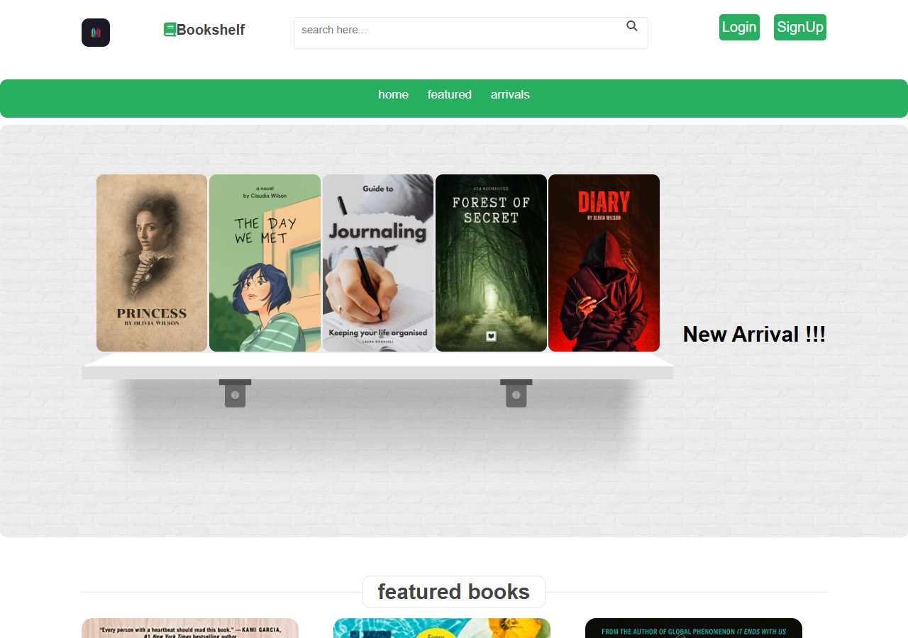
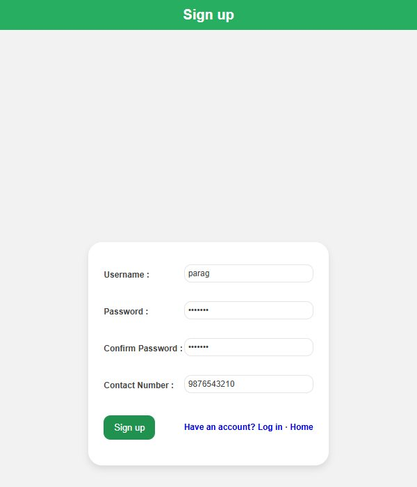

<h1 align="center">The Bookshelf</h1>

<p align="center"><strong>A bookshop front page with log-in and sign-up forms, in plain HTML, CSS and JavaScript.</strong></p>

<p align="center">
  <a href="https://cl0ud-9.github.io/Book-Website/"></a>
</p>

<p align="center">
  <a href="https://github.com/Cl0ud-9/Book-Website/actions/workflows/pages.yml"></a>
  <a href="LICENSE"></a>
  
</p>

<br>

<p align="center">
  
</p>

The Bookshelf is the front page of an imaginary bookshop: new arrivals on a shelf, featured books whose details open
with **show more**, a newsletter box and a list of arrivals. It began as a Web Technology course project.

| Page | What it does |
|---|---|
| [Home](https://cl0ud-9.github.io/Book-Website/) | Header with search, a menu that jumps to each section, a shelf of new arrivals, featured books with expandable details (jQuery), a newsletter box. |
| [Log in](https://cl0ud-9.github.io/Book-Website/login.html) | Username and password, checked in the browser. |
| [Sign up](https://cl0ud-9.github.io/Book-Website/signup.html) | Username, password with confirmation, and a 10-digit contact number, checked in the browser. |

<p align="center">
  
</p>

## Run it

Open `index.html` in a browser. That is all it needs.

To serve it the way a host would, with Node.js 18 or newer:

```bash
npm install
npm start          # http://localhost:3000
```

`server.js` is a small Express server that serves only the site's pages, styles and images.

## How it is published

Every push to `main` runs [`.github/workflows/pages.yml`](.github/workflows/pages.yml): it copies the pages, styles
and images, checks that every local link and image in them exists, and deploys them to GitHub Pages. A broken link
stops the deploy.

## Honest limits

- **No back end.** The forms check what you type and then show a message. Nothing is sent or stored, so there are no
  accounts, and the search box does not search.
- **Sample content.** The books, covers and prices are placeholders, not a real catalogue.

## Project structure

```text
index.html        the home page
login.html        log-in form
signup.html       sign-up form
css/style.css     styles for the home page (the forms carry their own)
image/            covers, the shelf and backgrounds
server.js         optional local server (npm start)
```

## License

**Source-available**: Copyright 2023-2026 Cloud/9, all rights reserved. You can read the code, run it yourself and
fork it to contribute back. Redistributing it, hosting copies, using it for a business or using it to train AI models
is not allowed without written permission. See [LICENSE](LICENSE). Icons, jQuery and the sample artwork keep their own
licenses, listed in [NOTICE](NOTICE). See [CONTRIBUTING.md](CONTRIBUTING.md), [SECURITY.md](SECURITY.md) and
[CHANGELOG.md](CHANGELOG.md).

<br>

<p align="center">
  <sub>Made by <a href="https://github.com/Cl0ud-9">Cloud/9</a>.</sub>
</p>
